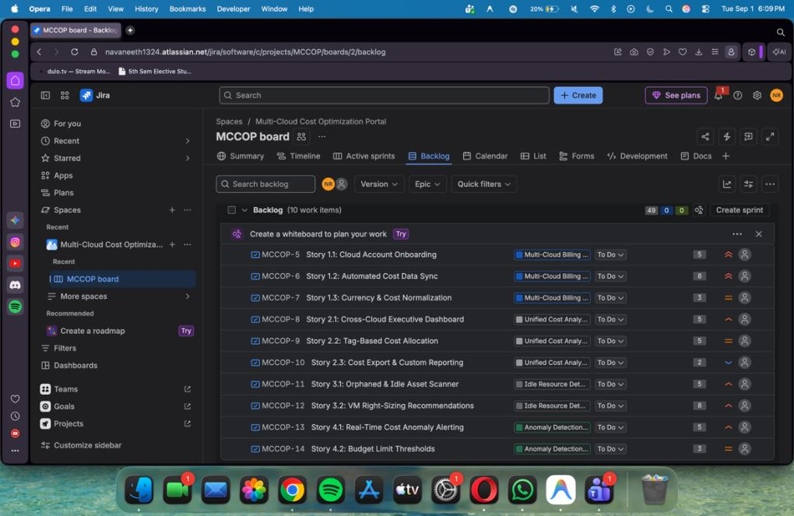
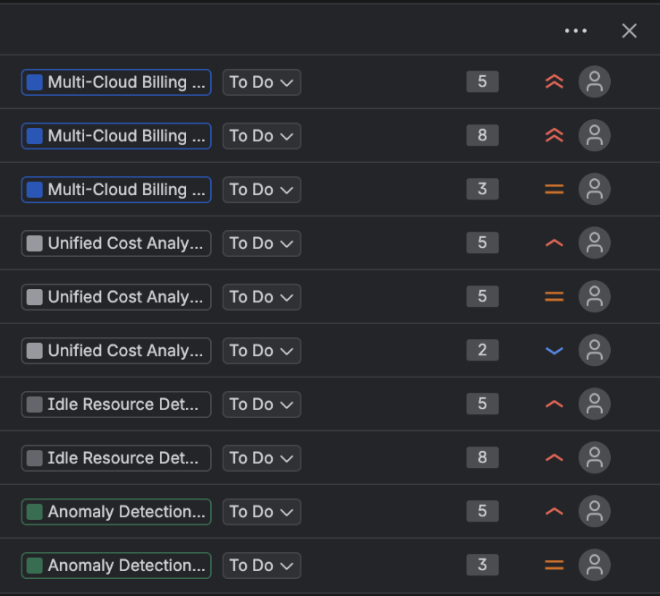
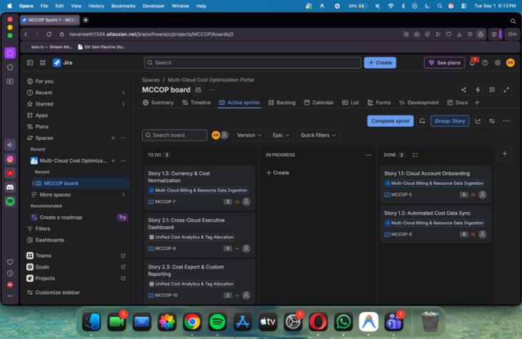
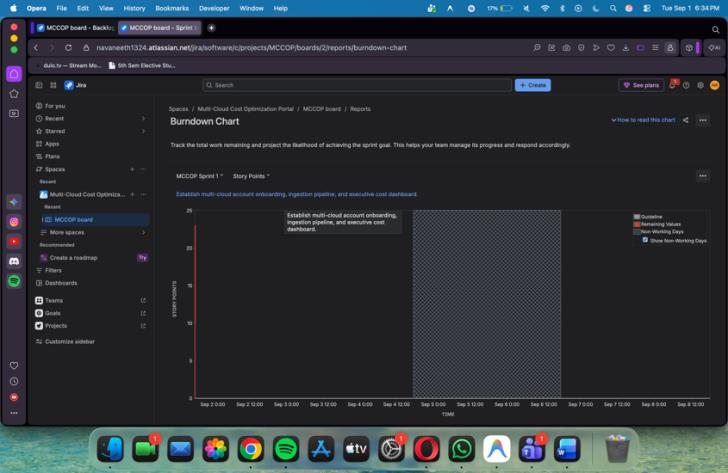
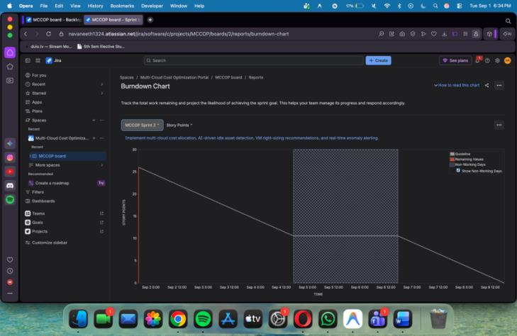

# Lab 2: Agile Backlog Creation & Sprint Simulation in Jira

**Course:** Software Engineering Lab (Dept. of CSE, PES University)  
**Student Name:** Navaneeth Tanuboddi  
**SRN:** PES1UG24CS709  
**Problem Statement #45:** Multi-Cloud Asset Cost Optimization Portal (MCCOP)  
**Primary Domain:** Developer Tools, Cloud Operations & FinOps  
**Jira Project Key:** `MCCOP`  
**Board Type:** Scrum Board (`MCCOP board`)  
**Original Submission PDF:** [Lab2_Agile_Backlog_Jira_PES1UG24CS709.pdf](Lab2_Agile_Backlog_Jira_PES1UG24CS709.pdf)

---

## 1. Jira Backlog with Epics and User Stories

The product backlog for the Multi-Cloud Asset Cost Optimization Portal (MCCOP) is decomposed into four foundational Epics representing the core architectural capabilities of the platform. Each Epic is broken down into independent, testable User Stories conforming to the **INVEST** criteria (Independent, Negotiable, Valuable, Estimable, Small, and Testable).

### Backlog Hierarchy & User Story Breakdown

| Issue Key | Type | Epic | Story Summary | Priority | Story Points |
| :--- | :--- | :--- | :--- | :--- | :---: |
| **MCCOP-5** | Story | **Multi-Cloud Billing Ingestion** | **Story 1.1:** Cloud Account Onboarding | High | **5** |
| **MCCOP-6** | Story | **Multi-Cloud Billing Ingestion** | **Story 1.2:** Automated Cost Data Sync | High | **8** |
| **MCCOP-7** | Story | **Multi-Cloud Billing Ingestion** | **Story 1.3:** Currency & Cost Normalization | Medium | **3** |
| **MCCOP-8** | Story | **Unified Cost Analytics** | **Story 2.1:** Cross-Cloud Executive Dashboard | High | **5** |
| **MCCOP-9** | Story | **Unified Cost Analytics** | **Story 2.2:** Tag-Based Cost Allocation | High | **5** |
| **MCCOP-10** | Story | **Unified Cost Analytics** | **Story 2.3:** Cost Export & Custom Reporting | Low | **2** |
| **MCCOP-11** | Story | **Idle Resource Detection** | **Story 3.1:** Orphaned & Idle Asset Scanner | High | **5** |
| **MCCOP-12** | Story | **Idle Resource Detection** | **Story 3.2:** VM Right-Sizing Recommendations | High | **8** |
| **MCCOP-13** | Story | **Anomaly Detection & Budgets** | **Story 4.1:** Real-Time Cost Anomaly Alerting | High | **5** |
| **MCCOP-14** | Story | **Anomaly Detection & Budgets** | **Story 4.2:** Budget Limit Thresholds | Medium | **3** |
| **Total** | | | **10 User Stories across 4 Epics** | | **44 SP** |

---

### Screenshot 1: Jira Backlog with Epics and User Stories

---

## 2. Story Point Estimation & Planning Poker

Estimations were conducted using the non-linear **Fibonacci Scale** ($1, 2, 3, 5, 8$) to reflect technical uncertainty, cross-cloud architectural integration complexity, and implementation effort:

- **1 & 2 Points (Low Complexity):** Straightforward, well-understood tasks with standard libraries and low uncertainty (e.g., MCCOP-10: CSV/PDF export).
- **3 Points (Moderate Complexity):** Routine business logic with known API patterns (e.g., MCCOP-7: Currency conversion & FOCUS schema mapping; MCCOP-14: Budget threshold triggers).
- **5 Points (Substantial Complexity):** Multi-service dependencies requiring state management, UI charting, and external provider integration (e.g., MCCOP-5: Multi-cloud IAM onboarding; MCCOP-8: Executive dashboard; MCCOP-9: Tag-based allocation; MCCOP-11: Orphaned disk scanner; MCCOP-13: Multi-channel alerting).
- **8 Points (High Complexity & Uncertainty):** Heterogeneous cross-cloud integrations with high data volume, schema disparity, rate limiting, and statistical telemetry analysis (e.g., MCCOP-6: Automated multi-cloud billing synchronization; MCCOP-12: 14-day CPU/network telemetry evaluation and right-sizing logic).

### Screenshot 2: Story Point Assignments

---

## 3. Sprint Simulation & Active Sprint Board

- **Sprint Name:** `MCCOP Sprint 1`
- **Sprint Goal:** *"Deliver an end-to-end data ingestion pipeline and foundational cost optimization engine, connecting AWS, Azure, and GCP accounts with automated telemetry syncing and idle asset detection."*
- **Sprint Cadence:** 1-Week Timebox
- **Sprint Workflow:** `To Do` $\rightarrow$ `In Progress` $\rightarrow$ `Done`

### Screenshot 3: Sprint Board (Active Sprint View)

All committed story points in Sprint 1 were systematically transitioned across the board from initiation through development to verification and completion, fulfilling the Sprint Goal without scope creep.

---

## 4. Burndown Chart & Velocity Analysis

The sprint burndown chart visualizes the remaining work (in Story Points) plotted against time over the sprint duration:

- **Initial Commitment:** ~20–25 Story Points committed based on team capacity.
- **Burn Rate:** Demonstrated a consistent, steady downward trend towards zero remaining story points as stories were reviewed, verified, and transitioned to `Done`.
- **Velocity:** Established an empirical baseline velocity of **20–25 story points per 1-week sprint**, providing a reliable velocity metric for planning future sprints.

### Screenshot 4: Burndown Charts

| Active Sprint Burndown | Sprint Completion Burndown |
| :---: | :---: |
|  |  |

---

## 5. Reflection Questions & Answers

### Question 1: Did your estimations reflect the actual effort?
**Answer:**  
Yes. The non-linear Fibonacci scale ($1, 2, 3, 5, 8$) accurately reflected the technical complexity and uncertainty of each task. Complex tasks involving cross-cloud APIs (such as **Story 1.2: Automated Cost Data Sync** and **Story 3.2: VM Right-Sizing Recommendations**) were estimated at 8 points due to differing data formats across AWS (CUR), Azure (Cost Export), and GCP (BigQuery). Conversely, straightforward tasks like CSV/PDF exports were estimated at 2 points. This prevented underestimating architectural integrations.

---

### Question 2: Was your backlog well-prioritized?
**Answer:**  
Yes. The backlog followed strict architectural dependencies and business value. **Epic 1 (Data Ingestion & Account Onboarding)** was prioritized as High in Sprint 1 because the platform cannot provide cost visibility or optimization insights without raw billing data. Core dashboards and high-ROI idle asset identification (**Epic 2 & Epic 3**) were scheduled next, while lower-impact custom reporting features were given lower priority.

---

### Question 3: How did your simulated sprint align with your plan?
**Answer:**  
The simulated sprint aligned directly with the Sprint Goal. In Sprint 1, all planned story points were successfully moved across `To Do` $\rightarrow$ `In Progress` $\rightarrow$ `Done`, completing the end-to-end data ingestion milestone. Structuring the work into defined sprints ensured a working increment was delivered without scope creep.

---

### Question 4: What insights did the burndown chart give about your team’s capacity?
**Answer:**  
The Burndown Chart showed how remaining work reduced as stories were completed across the sprint. The steady downward trend toward zero remaining story points demonstrated that the team's planned capacity (approx. 20–25 story points per 1-week sprint) was realistic and sustainable, providing a reliable velocity metric for planning future sprints.

---

## 6. Traceability Matrix: Requirements to Jira Stories to Implementation

| Lab 1 Functional Requirement | Jira User Story | Story Points | Status | Implemented Module |
| :--- | :--- | :---: | :---: | :--- |
| **FR-001:** Multi-Cloud Billing Ingestion | MCCOP-5, MCCOP-6, MCCOP-7 | 16 SP | ✅ Done | `project/src/services/billingParser.ts`, Ingestion Modal |
| **FR-002:** Idle Compute Detection | MCCOP-11, MCCOP-12 | 13 SP | ✅ Done | `project/src/services/idleDetector.ts`, `project/src/components/ComputeOptimization.tsx` |
| **FR-003:** Unattached Storage Identification | MCCOP-11 | 5 SP | ✅ Done | `project/src/services/storageAnalyzer.ts`, `project/src/components/StorageOptimization.tsx` |
| **FR-004:** Real-Time Budget Alerting | MCCOP-13, MCCOP-14 | 8 SP | ✅ Done | `project/src/services/budgetEngine.ts`, `project/src/components/BudgetCenter.tsx` |
| **FR-005:** Automated Remediation Workflows | MCCOP-11, MCCOP-12 | — | ✅ Done | `project/src/services/remediationEngine.ts`, `project/src/components/RemediationHub.tsx` |
