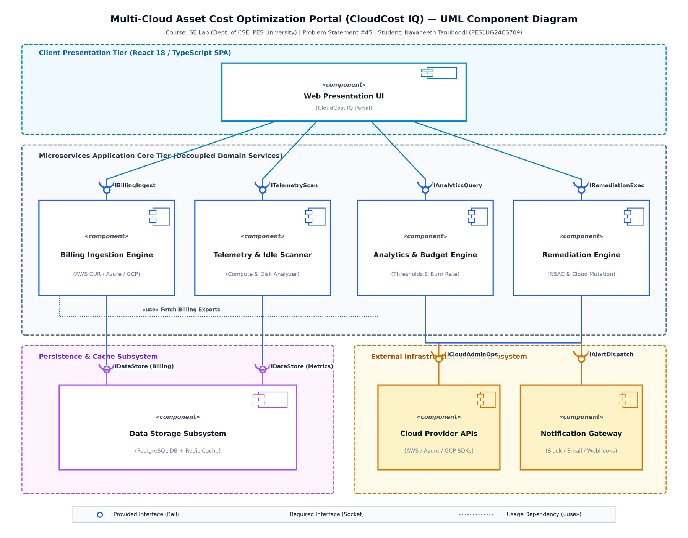
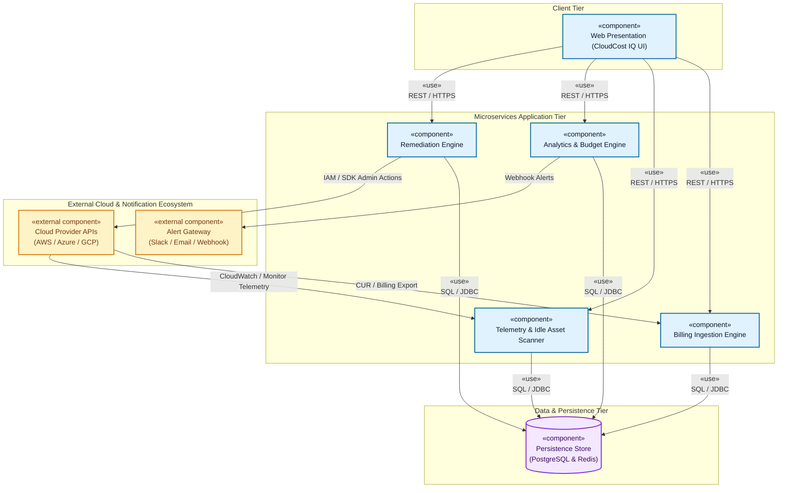
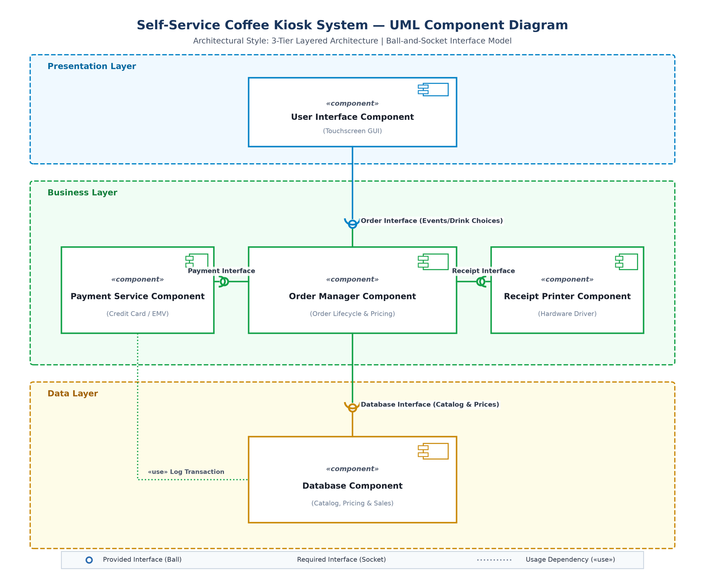
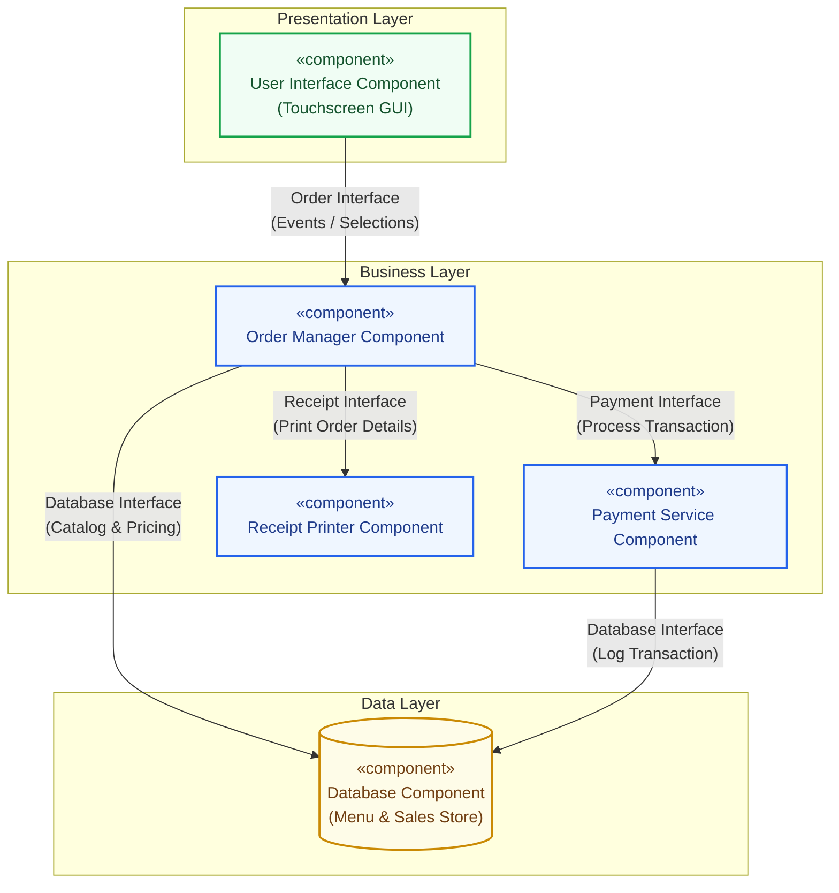

# Lab 3: Component Modelling & Architectural Pattern Selection

**Course:** Software Engineering Lab (Dept. of CSE, PES University)  
**Student Name:** Navaneeth Tanuboddi  
**SRN:** PES1UG24CS709  
**Problem Statement #45:** Multi-Cloud Asset Cost Optimization Portal (MCCOP)  
**Primary Domain:** Developer Tools, Cloud Operations & FinOps  
**Original Submission PDF:** [Lab3_Component_Modelling_PES1UG24CS709.pdf](Lab3_Component_Modelling_PES1UG24CS709.pdf)  

---

## Executive Summary & Objectives

The primary objective of this laboratory is to evaluate alternative software architectural styles, select the optimal pattern based on concrete non-functional and technical constraints, and design comprehensive **UML 2.0 Component Diagrams** utilizing standardized notation (components, ports, assembly connectors, and provided/required ball-and-socket interfaces).

To ensure complete rigor and alignment with academic guidelines, this deliverable addresses:
1. **Assigned Semester Project (Problem Statement #45):** Multi-Cloud Asset Cost Optimization Portal — evaluated under Microservices / Service-Based Architecture.
2. **Lab Manual Benchmark Scenario:** Self-Service Coffee Kiosk System — evaluated and designed under Layered (3-Tier) Architecture with the mandatory 1-page written justification.

---

## 1. Evaluation of Architectural Styles

Architectural patterns define the structural organization and communication topologies of software components. Below is an exhaustive comparative evaluation of the three canonical patterns analyzed in this laboratory:

| Architectural Metric | Layered (N-Tier) Architecture | Microservices Architecture | Client-Server Architecture |
| :--- | :--- | :--- | :--- |
| **Structural Topology** | Horizontal concentric layers (Presentation, Business/Domain, Persistence, Database). | Autonomous, domain-bounded services communicating via network protocols. | Centralized backend server node servicing multiple lightweight client endpoints. |
| **Component Coupling** | High between adjacent layers; changes in domain contracts ripple downward. | Loose coupling; bounded contexts communicate via versioned contracts/APIs. | Tight client-to-server protocol coupling; logic centralized on server. |
| **Scalability Dimension** | Monolithic scaling; entire application stack must be scaled horizontally. | Fine-grained independent scaling per service based on load characteristics. | Vertical server scaling or load-balanced stateless server pooling. |
| **Fault Isolation** | Poor; unhandled exception in one layer can crash entire application thread/process. | Superior; failures in non-critical services do not cascade across the system. | Poor; server downtime represents a single point of failure (SPOF) for all clients. |
| **Operational Complexity** | Low; single build pipeline, straightforward logging, trivial local deployment. | High; requires container orchestration (K8s), distributed tracing, and service meshes. | Moderate; requires server cluster management and database connection pooling. |
| **Network & Latency Overhead** | Negligible; in-memory function calls and direct pointers across layers. | High network overhead; inter-service RPC/HTTP/gRPC serialization latencies. | Low to moderate; standard client-server request/response over TCP/TLS. |
| **Data Consistency** | Strong consistency (ACID transactions managed via single database engine). | Eventual consistency; requires saga patterns and distributed transaction management. | Strong consistency managed centrally on the centralized database node. |
| **Best-Fit Domain** | Embedded appliances, self-contained kiosks, desktop tools, single-team apps. | High-throughput cloud platforms, multi-cloud analytics, polyglot enterprise stacks. | Web portals, simple client applications, centralized administrative consoles. |

### Pros & Cons Relative to Multi-Cloud FinOps

* **Layered Architecture:** While simple to develop initially, a layered monolith creates severe scaling bottlenecks when attempting to parse multi-gigabyte billing CSVs simultaneously with live user dashboard querying. Compute-heavy parsing starves interactive analytical queries.
* **Client-Server Architecture:** Centralizing all business logic in a single server creates a dangerous single point of failure (SPOF) and tightly couples volatile cloud provider API drivers (AWS, Azure, GCP) with core accounting engines.
* **Microservices / Service-Oriented Architecture (Selected):** Isolates high-throughput asynchronous billing ingestion from latency-critical financial visualization, ensuring resilience against third-party cloud API rate limits and permitting granular horizontal worker scaling.

---

## 2. Architectural Selection & Justification: Multi-Cloud Portal (MCCOP)

### Architecture Selection Statement
> *"We chose a **Service-Oriented / Microservices Architecture** for the **Multi-Cloud Asset Cost Optimization Portal (CloudCost IQ)**."*

### 2.1 Concrete Scenario-Related Justifications

1. **Heterogeneous Workload Characteristics & Elastic Scalability:**
   Multi-cloud billing ingestion involves processing voluminous, highly variable CSV/Parquet files (e.g., AWS Cost and Usage Reports up to 5 GB with millions of records) on a scheduled or on-demand basis. Conversely, the Executive FinOps Dashboard requires sub-second ($< 200\text{ ms}$) interactive response times for analytical filtering and cost charting. A microservices architecture enables dedicated worker replicas to scale horizontally during ingestion bursts without starving the memory or CPU threads required for interactive dashboard queries.

2. **Fault Isolation & Decoupling from Unreliable Cloud Provider APIs:**
   The portal interfaces with heterogeneous external APIs across AWS (Cost Explorer, CloudWatch), Microsoft Azure (Cost Management, Azure Monitor), and Google Cloud Platform (Cloud Billing, Cloud Monitoring). External cloud APIs are subject to transient network failures, strict throttling rate limits, and schema updates. Decoupling ingestion and telemetry scanning into autonomous services ensures that external upstream latency or throttling in Azure never degrades AWS cost analytics or prevents Cloud Administrators from executing local remediation actions.

### 2.2 Security Advantages

* **Strict Network Segmentation & Credential Vault Isolation:** Cloud provider credentials (AWS IAM Role ARNs, Azure Service Principal secrets, GCP Service Account keys) are restricted exclusively to the private container runtime of the Ingestion and Remediation engines. The public-facing Web Dashboard never has access to raw cloud credentials.
* **Zero-Trust Remediation Gateways with RBAC & MFA:** Remediation endpoints (stopping EC2 instances, snapshotting disks) require separate administrative authorization tokens verified against an identity provider (IdP). Even if a read-only FinOps analyst session is compromised, destructive cloud commands cannot be dispatched.

### 2.3 Performance Benefits

* **Asynchronous Non-Blocking Processing Pipelines:** When multi-gigabyte billing archives are uploaded, the Ingestion Engine immediately queues the payload into asynchronous streaming buffers, offloading CPU-intensive schema normalization and currency conversion to background worker pools. This guarantees that user dashboard requests consistently satisfy **NFR-001** ($\le 2\text{ minutes}$ for total batch ingestion; sub-second live UI responsiveness).

---

## 3. UML Component Diagram: Multi-Cloud Portal (MCCOP)

### 3.1 Component Breakdown & Stereotypes

1. **`Web Presentation Component` (`«component» CloudCost IQ UI`):**
   React 18 / TypeScript single-page dashboard providing interactive cost charts, tag breakdown heatmaps, idle asset tables, and remediation consoles.
2. **`Billing Ingestion Engine` (`«component» Billing Ingestion Service`):**
   Parses raw billing records (AWS CUR, Azure Cost Export, GCP Cloud Billing), extracts resource tags, normalizes currency to USD, and maps line items to unified FinOps FOCUS 1.0 schemas.
3. **`Telemetry & Idle Scanner` (`«component» Asset Scanner Service`):**
   Polls and analyzes 14-day rolling compute telemetry (CPU $< 5\%$) and unattached block storage volumes ($> 7$ days), computing projected monthly cost waste.
4. **`Analytics & Budget Engine` (`«component» Budget & Analytics Service`):**
   Evaluates departmental spending against multi-tier budget thresholds (80%, 90%, 100%) and generates predictive end-of-month spend forecasts.
5. **`Remediation Engine` (`«component» Remediation Service`):**
   Enforces RBAC and executes approved automated actions (stopping idle VMs, deleting unattached disks with safety snapshots) via cloud provider SDKs.
6. **`Persistence & Cache Layer` (`«component» Data Storage Subsystem`):**
   PostgreSQL database for normalized billing and audit logs, combined with Redis in-memory cache for instantaneous dashboard analytical queries.
7. **External System Actors:**
   `«external component» Cloud Provider APIs (AWS/Azure/GCP)` and `«external component» Multi-Channel Alert Gateway (Slack/Email/PagerDuty)`.

---

### 3.2 Component Diagram (MCCOP)





---

### 3.3 Interface Specifications (Ball-and-Socket Model)

| Interface Name | Provided By (Ball `—○`) | Required By (Socket `—) `) | Type / Protocol | Interface Description & Payload |
| :--- | :--- | :--- | :--- | :--- |
| **`IBillingIngest`** | `Billing Ingestion Engine` | `Web Presentation UI` | Synchronous REST / HTTPS | Ingests CSV uploads; returns batch parsing status, ingestion statistics, and normalized summary. |
| **`ITelemetryScan`** | `Telemetry & Idle Scanner` | `Web Presentation UI` | Synchronous REST / HTTPS | Triggers on-demand scans and queries detected idle VM/unattached disk lists with cost impact metrics. |
| **`IAnalyticsQuery`** | `Analytics & Budget Engine`| `Web Presentation UI` | Synchronous REST / HTTPS | Serves multi-cloud aggregate spend queries, tag distributions, and historical burn-rate analytics. |
| **`IRemediationExec`**| `Remediation Engine` | `Web Presentation UI` | Authenticated REST / HTTPS | Dispatches approved remediation tasks with mandatory MFA tokens; returns execution audit status. |
| **`IDataStore`** | `Data Storage Subsystem` | All Application Engines | Connection Pool (TCP/SQL) | CRUD persistence operations for normalized billing rows, asset inventory states, and audit trails. |
| **`ICloudTelemetry`** | `Cloud Provider APIs` | `Telemetry & Idle Scanner` | HTTPS / Cloud SDKs | Authenticated telemetry ingestion (AWS CloudWatch Metrics, Azure Monitor Metrics, GCP Cloud Monitoring). |
| **`ICloudAdminOps`** | `Cloud Provider APIs` | `Remediation Engine` | HTTPS / Cloud SDKs | Executes infrastructure mutation commands (e.g., `ec2:StopInstances`, `ebs:DeleteVolume`, Azure Compute APIs). |
| **`IAlertDispatch`** | `Alert Gateway` | `Analytics & Budget Engine`| Webhook / HTTPS POST | Dispatches real-time breach notifications containing JSON payloads to Slack, Email, and PagerDuty. |

---

## 4. Benchmark Scenario: Self-Service Coffee Kiosk System

To fulfill the explicit benchmark requirements on Pages 4–7 of the Lab 3 manual, the **Self-Service Coffee Kiosk System** is fully modeled below under a **Layered Architecture**.

### 4.1 System Overview & Technical Constraints
* **Core Requirements:** Selection of 3 coffee types (Espresso, Americano, Latte), 2 drink sizes (Small, Large), Credit Card payments only, and automatic receipt printing.
* **Constraints:** Touchscreen input processing, local receipt printer hardware interfacing, and structured storage for drink recipes and pricing catalogs.

### 4.2 Component & Layer Mapping (5 Components, 3 Layers)
1. **Presentation Layer:**
   * **`User Interface Component`:** Manages touchscreen event loops, displays dynamic visual menus, captures user drink/size selections, and presents payment prompts.
2. **Business Layer:**
   * **`Order Manager Component`:** Orchestrates the order lifecycle, calculates pricing totals based on size multipliers, validates order state transitions, and coordinates payment and printing.
   * **`Payment Service Component`:** Integrates with the physical credit card EMV terminal, securely processes transactions, validates authorizations, and emits payment receipts.
   * **`Receipt Printer Component`:** Interfaces directly with hardware printer drivers via local USB/Serial ports to format and print order receipts containing itemized details.
3. **Data Layer:**
   * **`Database Component`:** Local SQLite/embedded relational database maintaining coffee catalog data, drink size price matrices, tax rules, and transactional sales logs.

---

### 4.3 Component Diagram: Coffee Kiosk System





---

### 4.4 One-Page Written Justification (As Required by Lab Manual Step 5)

```text
========================================================================================
                          ARCHITECTURAL DECISION & JUSTIFICATION
========================================================================================

Architecture Selection: "We chose Layered Architecture for the Self-Service Coffee Kiosk System."

1. Architectural Choice:
We selected the 3-Tier Layered (N-Tier) Architectural Pattern, organized into Presentation,
Business, and Data layers.

2. Two Specific Scenario-Related Reasons:
a) Clear Separation of UI and Hardware Peripherals:
   The kiosk must interact with specialized, heterogeneous physical hardware devices 
   (touchscreen interface and thermal receipt printer) while managing business order 
   state and local menu pricing. A layered architecture cleanly isolates hardware-specific 
   driver interactions (Receipt Printer Component) and touchscreen UI rendering (User 
   Interface Component) from core ordering business rules. This allows driver or screen 
   updates without altering the underlying pricing logic.
b) Self-Contained Deployment Simplicity on Single Kiosk Hardware:
   A self-service kiosk operates as an isolated physical edge appliance within a café. 
   Deploying microservices would introduce unwarranted network latency, inter-process 
   communication overhead, and operational maintenance burdens. The layered architecture 
   executes as a unified, deterministic in-memory process, maximizing reliability and 
   eliminating distributed failure modes.

3. Security Advantage:
Strict Isolation of Payment Processing (PCI-DSS Scoping):
By isolating credit card processing into a dedicated Payment Service Component within the 
business layer, cardholder data and EMV terminal communication are partitioned from the 
general touchscreen user interface. The UI never inspects or stores raw primary account 
numbers (PAN), significantly reducing the system's PCI-DSS audit scope and preventing UI 
vulnerabilities from exposing financial data.

4. Performance Benefit:
Zero-Network In-Memory Execution & Sub-Millisecond Touchscreen Latency:
Because all layers reside on the local kiosk computing unit, interactions between the 
Presentation Layer, Order Manager, and local SQLite Database Component occur via high-speed 
in-memory method invocations and local socket interfaces rather than network serialization. 
This delivers instantaneous, lag-free touchscreen feedback during drink customization and 
guarantees sub-second receipt printing upon payment confirmation.
========================================================================================
```

---

## 5. Traceability Matrix: Requirements to Components & Interfaces

| Requirement ID | Requirement Scope | Mapped Component | Provided Interface | Required Interface | Implementation Source Code |
| :--- | :--- | :--- | :--- | :--- | :--- |
| **FR-001** | Multi-Cloud Billing Ingestion & Tag Normalization | `Billing Ingestion Engine` | `IBillingIngest` | `IDataStore`, `ICloudBillingAPI` | [`project/src/services/billingParser.ts`](../project/src/services/billingParser.ts) |
| **FR-002** | Idle Compute Instance Detection ($< 5\%$ CPU) | `Telemetry & Idle Scanner` | `ITelemetryScan` | `IDataStore`, `ICloudTelemetry` | [`project/src/services/idleDetector.ts`](../project/src/services/idleDetector.ts) |
| **FR-003** | Unattached Block Storage Volume Scanning | `Telemetry & Idle Scanner` | `ITelemetryScan` | `IDataStore`, `ICloudTelemetry` | [`project/src/services/storageAnalyzer.ts`](../project/src/services/storageAnalyzer.ts) |
| **FR-004** | Budget Limit Monitoring & Multi-Channel Alerting | `Analytics & Budget Engine` | `IAnalyticsQuery` | `IAlertDispatch`, `IDataStore` | [`project/src/services/budgetEngine.ts`](../project/src/services/budgetEngine.ts) |
| **FR-005** | Automated Cloud Remediation & Audit Logging | `Remediation Engine` | `IRemediationExec` | `ICloudAdminOps`, `IDataStore` | [`project/src/services/remediationEngine.ts`](../project/src/services/remediationEngine.ts) |
| **NFR-001** | Ingestion Performance & Low Latency ($< 2\text{ min}$) | `Billing Ingestion Engine` | Asynchronous Stream | In-Memory Batch Buffer | High-throughput async chunk parser |
| **NFR-002** | Security & Role-Based Access Control (RBAC) | `Remediation Engine` | `IRemediationExec` | MFA Authorization Gate | [`project/src/components/RemediationHub.tsx`](../project/src/components/RemediationHub.tsx) |

---

## 6. Deliverables & Verification Checklist

* [x] **Architectural Styles Evaluation:** Comprehensive matrix comparing Layered, Microservices, and Client-Server architectures.
* [x] **Architectural Selection & Justification:** Clear statements, scenario reasons, security advantages, and performance benefits for both assigned MCCOP and Coffee Kiosk.
* [x] **UML Component Diagrams:** Professional diagrams with ball-and-socket notation, component boxes, and assembly connectors.
* [x] **Standardized Written Justification:** 1-page structured statement adhering to Page 7 manual guidelines.
* [x] **Lab Report PDF:** Formatted, publication-ready PDF submission report ([`Lab3_Component_Modelling_PES1UG24CS709.pdf`](Lab3_Component_Modelling_PES1UG24CS709.pdf)).
