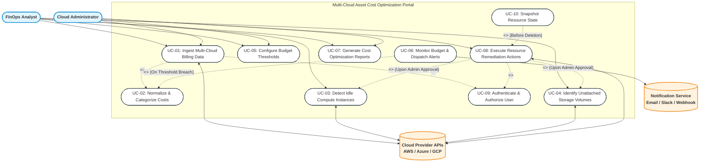

# Lab 1: Requirements Engineering & UML Use-Case Modelling

**Course:** Software Engineering Lab (Dept. of CSE, PES University)  
**Problem Statement #45:** Multi-Cloud Asset Cost Optimization Portal  
**Primary Domain:** Developer Tools & IT Operations  
**Target Stakeholders / Actors:** FinOps Analyst, Cloud Administrator  

---

## 1. Problem Context & Overview
Modern enterprises operate across multiple cloud providers (AWS, Microsoft Azure, and Google Cloud Platform), resulting in fragmented billing data, unmonitored resource sprawl, and unexpected cost overruns. The **Multi-Cloud Asset Cost Optimization Portal** is an IT operations and FinOps analytics platform designed to:
- Ingest and normalize raw billing reports (CSV exports) and telemetry from AWS, Azure, and GCP.
- Identify financial waste including unattached persistent block storage volumes (e.g., AWS EBS, Azure Managed Disks, GCP Persistent Disks) and idle compute instances (e.g., EC2, Azure VMs, Compute Engine instances running with $< 5\%$ CPU utilization over 14 days).
- Monitor budget thresholds and dispatch real-time multi-channel alerts upon anomalous spend or budget breaches.
- Provide actionable cost-saving recommendations and facilitate administrative remediation.

---

## 2. Requirements Specifications

### 2.1 Functional Requirements (FR-001 to FR-005)

| ID | Requirement Description | Priority | Acceptance Criteria | Rationale |
| :--- | :--- | :--- | :--- | :--- |
| **FR-001** | **Multi-Cloud Billing Ingestion & Tag Categorization** The system shall ingest standard billing CSV exports from AWS (CUR), Azure (Cost Management Export), and GCP (Cloud Billing Export), and categorize costs by service, account ID, region, and project resource tags. | **High** | **Pass:** Billing CSVs from AWS, Azure, and GCP are parsed and mapped into normalized cost categories with $\ge 99.9\%$ tag accuracy. **Fail:** Parsing errors, unmapped schema attributes, or dropped line-items. | Unifies heterogeneous multi-cloud billing formats into a centralized cost-allocation model for cross-cloud visibility. |
| **FR-002** | **Idle Compute Instance Detection** The system shall evaluate historical compute metric telemetry (CPU utilization, network I/O) and flag virtual machine instances operating with $< 5\%$ average CPU utilization over a rolling 14-day window. | **High** | **Pass:** Idle instances flagged with estimated monthly dollar savings; confidence score attached. **Fail:** Active compute workloads ($> 5\%$ average utilization) misclassified as idle. | Compute instances account for the largest proportion of cloud waste; automated identification yields immediate ROI. |
| **FR-003** | **Unattached Storage Volume Identification** The system shall scan cloud asset inventories and identify block storage volumes (AWS EBS, Azure Managed Disks, GCP Persistent Disks) that have remained in an unattached/available state for $> 7$ consecutive days. | **Medium** | **Pass:** Generates a list of all orphan volumes indicating volume ID, size (GB), storage tier, and accrued idle cost. **Fail:** Storage volumes attached to running/stopped instances or active backups flagged as unattached. | Orphaned storage volumes persist billing even after compute instances are decommissioned, creating silent cost leaks. |
| **FR-004** | **Budget Threshold Monitoring & Alert Dispatch** The system shall continuously evaluate aggregated expenditures against user-defined monthly budget thresholds and dispatch breach alerts via Email, Slack, and Webhook when spend exceeds 80%, 90%, and 100%. | **High** | **Pass:** Multi-channel alert dispatched within 60 seconds of a budget breach or projected forecast overrun. **Fail:** Missed threshold breaches or false positive alerts triggered without limit violation. | Proactive notifications prevent end-of-month budget shocks and enable rapid intervention by engineering teams. |
| **FR-005** | **Remediation Plan Generation & Action Execution** The system shall provide actionable optimization recommendations (e.g., stop/terminate idle instances, snapshot & delete unattached volumes) and allow authorized Cloud Administrators to approve or trigger remediation actions. | **Medium** | **Pass:** Generates a downloadable remediation plan and successfully executes approved cloud provider API commands with audit logging. **Fail:** Unauthorized execution of destructive actions or failure to generate verification audit logs. | Closes the loop between FinOps analysis and IT operations enforcement to realize projected cost reductions safely. |

---

### 2.2 Non-Functional Requirements (NFR-001 & NFR-002)

| ID | Type | Description | Priority | Acceptance Criteria | Rationale |
| :--- | :--- | :--- | :--- | :--- | :--- |
| **NFR-001** | **Performance & Scalability** | The portal must parse multi-gigabyte cloud billing CSV files (up to 5 GB / millions of line items) and refresh cost analytics dashboards within **$\le 2$ minutes** under peak load. | **High** | **Pass:** End-to-end batch ingestion, schema normalization, and dashboard rendering complete in $< 120$ seconds during simulated 5 GB load testing. **Fail:** Ingestion timeout, UI dashboard lag $> 120$ seconds, or out-of-memory crashes. | Cloud billing datasets are voluminous; fast processing ensures timely financial reporting without blocking analytical operations. |
| **NFR-002** | **Security & Access Control (RBAC)** | The system must enforce Role-Based Access Control (RBAC) and end-to-end encryption (AES-256 at rest, TLS 1.3 in transit) for all cloud credentials, billing data, and remediation endpoints. | **Critical** | **Pass:** FinOps Analysts have read-only analytics access; only authenticated Cloud Administrators with MFA can trigger remediation; penetration tests confirm zero credential exposure. **Fail:** Privilege escalation allowed, or cloud credentials stored/transmitted in plaintext. | Billing and infrastructure credentials are high-value targets; unauthorized access could lead to data exfiltration or unintended resource termination. |

---

## 3. UML Use-Case Diagram

### 3.1 Actors
- **Primary Human Actors:**
  - `FinOps Analyst`: Analyzes cost trends, reviews idle assets, configures budget limits, and evaluates financial ROI.
  - `Cloud Administrator`: Manages cloud account credentials, configures threshold policies, reviews recommendations, and executes remediation actions.
- **Secondary / Supporting System Actors:**
  - `Cloud Provider APIs` (AWS, Azure, GCP): Sources billing CSV files, exposes instance telemetry, and executes remediation commands.
  - `Alert Notification Service` (Slack / Email / Webhook): Dispatches threshold breach alerts to operations teams.

### 3.2 Diagram (Mermaid Notation)

---

## 4. Use-Case Flow Specification

### Use Case Specification: `UC-03` — Detect Idle Compute Instances & Generate Optimization Recommendations

| Element | Description |
| :--- | :--- |
| **Use Case ID** | **UC-03** |
| **Use Case Name** | Detect Idle Compute Instances & Generate Optimization Recommendations |
| **Primary Actor** | FinOps Analyst |
| **Secondary Actors** | Cloud Administrator, Cloud Provider Telemetry APIs (AWS CloudWatch, Azure Monitor, GCP Cloud Monitoring) |
| **Priority** | High |
| **Scope** | Multi-Cloud Asset Cost Optimization Portal — Optimization & Analytics Engine |
| **Trigger** | Scheduled periodic analysis job (e.g., daily at midnight) or manual trigger by the FinOps Analyst via the Cost Analysis Dashboard. |
| **Brief Description** | The system inspects multi-cloud compute inventory across AWS, Azure, and GCP, collects 14-day metric telemetry (CPU and network I/O), identifies instances running with $< 5\%$ average CPU utilization, calculates projected monthly savings, and publishes actionable remediation recommendations. |

#### Preconditions
1. User (FinOps Analyst) is authenticated with valid RBAC permissions.
2. Cloud Provider service credentials / IAM read-only roles are configured and active for target AWS, Azure, and GCP accounts.
3. Billing and inventory data for the target evaluation period are synchronized.

#### Postconditions
1. **Success Postcondition:** All compute instances with $< 5\%$ average CPU utilization over 14 days are flagged with status `IDLE` in the database, cost savings are calculated, and a remediation report is generated.
2. **Failure Postcondition:** The system logs metric collection errors without modifying prior state, alerting the Cloud Administrator of connectivity or permission issues.

---

### Flow of Events

#### Main Success Scenario (Basic Flow)
1. **Initiation:** The FinOps Analyst navigates to the "Compute Optimization" module and selects target cloud accounts and a 14-day analysis window.
2. **Asset Retrieval:** The system queries Cloud Provider APIs to enumerate all active virtual machine instances (EC2, Azure VM, GCP Compute Engine).
3. **Telemetry Fetching:** The system invokes CloudWatch / Azure Monitor / GCP Monitoring APIs to fetch 14-day time-series CPU utilization and Network In/Out metrics for each instance.
4. **Metric Evaluation:** The system computes the average and 95th-percentile utilization:
   - Evaluates rule: $\text{Avg(CPU Utilization)} < 5\%$ AND $\text{Network I/O} < 100 \text{ MB/day}$.
5. **Cost Savings Computation:** For every matching instance, the system cross-references the billing catalog to calculate the monthly cost and projected savings if stopped or terminated.
6. **Recommendation Generation:** The system categorizes the instance as `IDLE`, assigns a recommendation action (`Right-Size` or `Terminate`), and estimates risk/confidence scores.
7. **Display & Notification:** The system renders the cost optimization report on the portal dashboard and flags recommendations ready for Cloud Administrator review.

---

#### Alternate & Exception Flows

- **Alternate Flow 1 (Exclusion Tags Present):**
  - At **Step 4**, the system checks instance tags.
  - If the instance contains an exclusion tag (e.g., `Environment=DisasterRecovery`, `FinOps=Exempt`, or `Schedule=Seasonal`), the system marks the instance as `EXEMPT_IDLE`, records the tag reason, and excludes its cost from the gross potential savings calculation.
  - The flow resumes at **Step 6**.

- **Alternate Flow 2 (Downsizing / Right-Sizing Alternative):**
  - At **Step 4**, if CPU utilization is between $5\%$ and $15\%$ and peak memory is $< 30\%$, the system categorizes the instance as `UNDERUTILIZED` rather than `IDLE`.
  - At **Step 6**, the system suggests a next-generation smaller SKU (e.g., `m5.2xlarge` $\rightarrow$ `m5.large`) and computes fractional savings.
  - The flow resumes at **Step 7**.

- **Exception Flow 1 (Cloud Telemetry API Failure / Rate Limit):**
  - At **Step 3**, if a Cloud Provider API returns a `429 Too Many Requests` or `401 Unauthorized` token expiry:
    1. The system attempts exponential backoff retry (up to 3 attempts).
    2. If retry fails, the system logs the failure for the specific provider account.
    3. The system renders the report with available data and displays a warning banner: *"Telemetry incomplete for Azure Account #1042 — Rate limit exceeded"*.
    4. An alert is sent to the Cloud Administrator to renew IAM credentials.
